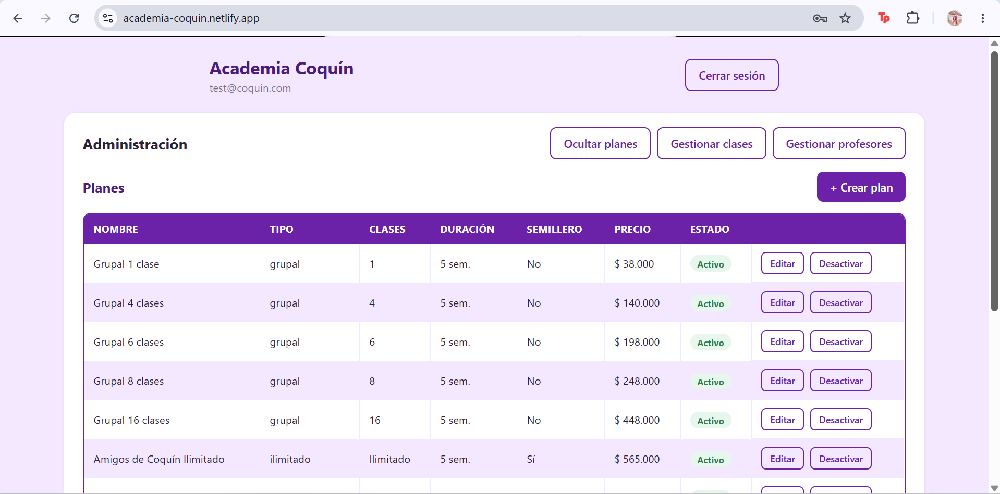
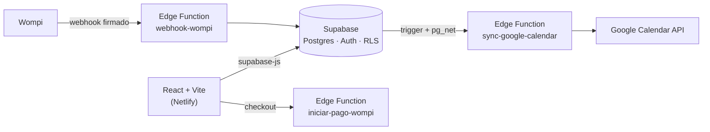

# Sistema de reservas para academias

Sistema web de reservas de clases para academias que venden **paquetes y membresías** en lugar de clases sueltas (desarrollado y validado sobre el caso de una academia de pole dance). Cada reserva descuenta, en una sola operación atómica, el cupo de la sesión **y** una clase del paquete de la estudiante.

> **English summary:** Full-stack class-booking system (React + Supabase/Postgres) for academies that sell class packages and memberships. Business rules (capacity, plan credits, a 48-hour cancellation window) are enforced in the database with triggers and `security definer` RPC functions, so they can't be bypassed from the client. Includes an admin panel, Google Calendar sync via an Edge Function, and a Wompi payment integration ready to be connected. **Proprietary code, all rights reserved. Not open source.**

---



---

## Estado del proyecto

| Componente | Estado |
|---|---|
| Reservas, cupos y créditos de plan | ✅ Completo |
| Panel de administración (planes, clases, profesores) | ✅ Completo |
| Sincronización con Google Calendar | ✅ Completo, probado de punta a punta |
| Pagos con Wompi (checkout + webhook verificado por firma) | 🟡 Implementado en código, **listo para enlazar con una cuenta Wompi y probar en Sandbox** |
| Pruebas con usuarias reales y ajustes finales de personalización | ⏸️ Pendiente |
| Perfiles de menores con consentimiento parental | ⬜ No iniciado |

Este sistema nació como una **propuesta técnica** para una academia. El resultado le gustó al cliente, pero la entrega y la personalización final (que iban a hacerse después de probarlo con usuarias reales) quedaron en pausa por falta de fondos. **El código no ha sido entregado ni vendido.**

---

## El problema

Una academia que vende paquetes (4, 8, 16 clases, planes ilimitados) con vigencia por semanas, y cuyos salones tienen un número físico de cupos, termina gestionando todo por mensajes y hojas de cálculo. Eso produce sobrecupos y errores en el control de créditos.

## Qué hace

**Estudiantes**
- Registro, confirmación de correo, inicio de sesión y recuperación de contraseña (mensajes en español).
- Ven su plan activo y cuántas clases le quedan.
- Consultan las próximas clases con **cupos en tiempo real**, profesor y disciplina.
- Reservan y cancelan; al cancelar a tiempo, el crédito vuelve al plan.
- Compran planes en línea (con la integración de pagos conectada).

**Administración**
- Panel para crear, editar y activar/desactivar **planes**, **clases** y **profesores**, pensado para una persona sin conocimientos de SQL.
- La cuenta administradora no puede reservar clases: su vista es solo de gestión.

**Automatización**
- Cada sesión creada, modificada o eliminada se refleja automáticamente en Google Calendar.

## Reglas de negocio

| Regla | Dónde se aplica |
|---|---|
| No se puede reservar una sesión sin cupo | Trigger `fn_validar_cupo` |
| Reservar descuenta un crédito del plan (los planes ilimitados no descuentan) | Trigger `fn_validar_cupo` |
| Solo se puede cancelar hasta 48 h antes de la clase | Función RPC `cancelar_reserva` |
| Cancelar a tiempo devuelve el crédito al plan | Función RPC `cancelar_reserva` |
| Cada usuaria solo ve y crea sus propias reservas | Políticas RLS |

## Decisión de diseño clave

**Las reglas viven en la base de datos, no en el frontend.** El botón "Cancelar" se deshabilita en la interfaz cuando faltan menos de 48 h, pero eso es solo experiencia de usuario: el bloqueo real lo hace Postgres. Así, aunque alguien manipule el DOM o llame directo a la API, no puede saltarse las reglas.

Otras decisiones:
- **`clases_restantes = NULL` significa plan ilimitado**, en lugar de usar un número "mágico" como 9999.
- **Desactivar un plan no lo borra**, para no romper el historial de compras que lo referencian.
- **`categoria` y `disciplina` son dimensiones separadas** en `clases`: la primera sirve para filtrar contenido a futuro, la segunda es el catálogo real de lo que se enseña.
- **El pago se confirma solo por webhook.** La redirección del navegador nunca activa un plan; solo lo hace el evento firmado de Wompi.

## Arquitectura



## Stack

- **Frontend:** React, Vite, `@supabase/supabase-js`
- **Backend:** Supabase (PostgreSQL, Auth, Row Level Security, funciones RPC, Edge Functions en Deno/TypeScript)
- **Integraciones:** Google Calendar API, Wompi (pagos)
- **Despliegue:** Netlify

## Estructura del proyecto

```
├── src/
│   ├── App.jsx              # Autenticación, vista de estudiante y navegación admin
│   ├── ComprarPlan.jsx      # Compra de planes
│   ├── PanelPlanes.jsx      # Administración de planes
│   ├── PanelClases.jsx      # Administración de clases
│   ├── PanelProfesores.jsx  # Administración de profesores
│   ├── App.css
│   ├── main.jsx
│   └── supabaseClient.js
└── supabase/
    └── functions/
        ├── sync-google-calendar/
        ├── iniciar-pago-wompi/
        └── webhook-wompi/
```

## Retos técnicos resueltos

- **Validación atómica de dos recursos a la vez** (cupo de la sesión + crédito del plan) con un único trigger, evitando estados intermedios inconsistentes.
- **Reglas imposibles de evadir desde el cliente**, mediante funciones `security definer` y RLS.
- **Disparar una Edge Function desde cambios en una tabla** construyendo el trigger manualmente con `pg_net`, y depurándolo consultando `net._http_response`.
- **Webhook de pagos con validación de firma (checksum SHA-256)** antes de confiar en cualquier dato del evento.
- **Detección de registro duplicado:** Supabase no devuelve error cuando el correo ya existe; el frontend detecta la respuesta con `identities` vacío para avisar a la usuaria.
- **Experiencia de formularios:** errores de autenticación en español, botones que se bloquean durante la petición (evita reservas duplicadas) y consentimiento de tratamiento de datos al registrarse.

---

## Integración de pagos (Wompi)

La integración está escrita y lista para conectarse: crea la transacción, redirige al checkout y activa el plan solo cuando llega el webhook firmado.

**Para enlazarla** hace falta una cuenta Wompi y configurar los *secrets* de las Edge Functions (llaves y secreto de eventos), apuntar el webhook del dashboard a `/functions/v1/webhook-wompi` y probar primero en Sandbox.

**Se enlazará cuando el código sea adquirido** por un cliente (ver más abajo). Hasta entonces no hay ninguna cuenta de pagos conectada.

---

## Autoría y derechos

**Autora y titular de los derechos de autor: Emily Tatiana Rojas Leiva** ([@emily9991](https://github.com/emily9991)).

Este sistema fue diseñado, desarrollado y mantenido por mí como parte de una **propuesta** para ofrecer un sistema de agendamiento a la medida, definido en conversaciones con el cliente. Esa propuesta no llegó a formalizarse en una entrega ni en una cesión de derechos, por lo que **el código me pertenece como creadora intelectual**.

## Licencia

© 2026 Emily Tatiana Rojas Leiva. **Todos los derechos reservados.**

Este código se publica únicamente para consulta y como muestra de mi trabajo. **No está permitido** copiarlo, modificarlo, desplegarlo, redistribuirlo ni usarlo comercialmente sin mi autorización por escrito.

## Adquisición y futuro del proyecto

- **Adquisición del código:** cualquier academia o persona interesada puede adquirir el sistema, o una licencia de uso, escribiéndome por GitHub. La conexión con Wompi y la entrega de la personalización final se realizan una vez se concrete la adquisición.
- **Cliente original:** el cliente para quien se hizo la propuesta puede adquirirlo, con **opción de pago en cuotas**, hasta el **31 de diciembre de 2026**.
- **Después de esa fecha:** si no hay adquisición, el código se transformará en un **producto SaaS multi-academia**, con modelo de afiliación para que varias academias usen la plataforma. Esta licencia se actualizará entonces, y las condiciones de uso las definirá la autora.

## Ejecutar en local (solo para evaluación)

Requisitos: Node.js 18+ y un proyecto de Supabase propio.

```bash
git clone https://github.com/emily9991/System-for-academies.git
cd System-for-academies
npm install
cp .env.example .env     # completa con las credenciales de tu proyecto
npm run dev
```

Variables de entorno (`.env`):

```
VITE_SUPABASE_URL=https://<tu-proyecto>.supabase.co
VITE_SUPABASE_ANON_KEY=<tu-anon-key>
```

> El frontend solo usa la clave pública (`anon`). Las claves privadas viven únicamente como *secrets* de las Edge Functions y nunca se versionan. El uso del código fuera de la evaluación personal requiere autorización (ver Licencia).
