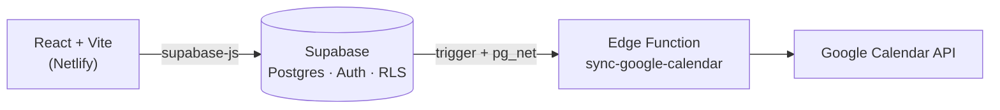

# Academia Coquín — Sistema de reservas

Sistema web de reservas de clases para una academia de pole dance que vende **paquetes y membresías** en lugar de clases sueltas. Cada reserva descuenta, en una sola operación atómica, el cupo de la sesión **y** una clase del paquete de la estudiante.

> **English summary:** Full-stack class-booking system (React + Supabase/Postgres) for a pole dance academy. Business rules — capacity, plan credits, and a 48-hour cancellation window — are enforced in the database with triggers and `security definer` RPC functions, so they can't be bypassed from the client. Includes an admin panel and a Google Calendar sync via an Edge Function.

<!-- Demo en vivo: agrega aquí el link solo si el cliente lo autorizó -->
<!--  -->

---

## El problema

La academia no vende clases sueltas; vende paquetes (4, 8, 16 clases, planes ilimitados) con vigencia por semanas. Además, cada salón tiene un número físico de poles, así que el cupo es limitado. Gestionarlo por mensajes y hojas de cálculo generaba errores de sobrecupo y de control de créditos.

## Qué hace

**Estudiantes**
- Registro, confirmación de correo, inicio de sesión y recuperación de contraseña (mensajes en español).
- Ven su plan activo y cuántas clases le quedan.
- Consultan las próximas clases con **cupos en tiempo real**, profesor y disciplina.
- Reservan y cancelan; al cancelar a tiempo, el crédito vuelve al plan.

**Administración**
- Panel para crear, editar y activar/desactivar **planes**, **clases** y **profesores**, pensado para una persona sin conocimientos de SQL.
- La cuenta administradora no puede reservar clases: su vista es solo de gestión.

**Automatización**
- Cada sesión creada, modificada o eliminada se refleja automáticamente en Google Calendar.

## Reglas de negocio

| Regla | Dónde se aplica |
|---|---|
| No se puede reservar una sesión sin cupo | Trigger `fn_validar_cupo` |
| Reservar descuenta un crédito del plan (los planes ilimitados no descuentan) | Trigger `fn_validar_cupo` |
| Solo se puede cancelar hasta 48 h antes de la clase | Función RPC `cancelar_reserva` |
| Cancelar a tiempo devuelve el crédito al plan | Función RPC `cancelar_reserva` |
| Cada usuaria solo ve y crea sus propias reservas | Políticas RLS |

## Decisión de diseño clave

**Las reglas viven en la base de datos, no en el frontend.** El botón "Cancelar" se deshabilita en la interfaz cuando faltan menos de 48 h, pero eso es solo experiencia de usuario: el bloqueo real lo hace Postgres. Así, aunque alguien manipule el DOM o llame directo a la API, no puede saltarse las reglas.

Otras decisiones:
- **`clases_restantes = NULL` significa plan ilimitado**, en lugar de usar un número "mágico" como 9999.
- **Desactivar un plan no lo borra**, para no romper el historial de compras que lo referencian.
- **`categoria` y `disciplina` son dimensiones separadas** en `clases`: la primera sirve para filtrar contenido a futuro, la segunda es el catálogo real de lo que se enseña.

## Arquitectura



## Stack

- **Frontend:** React, Vite, `@supabase/supabase-js`
- **Backend:** Supabase (PostgreSQL, Auth, Row Level Security, funciones RPC, Edge Functions en Deno/TypeScript)
- **Integraciones:** Google Calendar API
- **Despliegue:** Netlify

## Estructura del proyecto

```
├── src/
│   ├── App.jsx              # Autenticación, vista de estudiante y navegación admin
│   ├── PanelPlanes.jsx      # Administración de planes
│   ├── PanelClases.jsx      # Administración de clases
│   ├── PanelProfesores.jsx  # Administración de profesores
│   ├── App.css
│   └── supabaseClient.js
└── supabase/
    ├── migrations/          # Esquema, reglas de negocio y datos de ejemplo
    └── functions/
        └── sync-google-calendar/
```

## Ejecutar en local

Requisitos: Node.js 18+ y un proyecto de Supabase.

```bash
git clone https://github.com/emily9991/<nombre-del-repo>.git
cd <nombre-del-repo>
npm install
cp .env.example .env     # completa con las credenciales de tu proyecto
npm run dev
```

Variables de entorno (`.env`):

```
VITE_SUPABASE_URL=https://<tu-proyecto>.supabase.co
VITE_SUPABASE_ANON_KEY=<tu-anon-key>
```

Luego ejecuta, en orden, los archivos de `supabase/migrations/` desde el SQL Editor de Supabase.

> El frontend solo usa la clave pública (`anon`). Las claves privadas viven únicamente como *secrets* de las Edge Functions y nunca se versionan.

## Retos técnicos resueltos

- **Validación atómica de dos recursos a la vez** (cupo de la sesión + crédito del plan) con un único trigger, evitando estados intermedios inconsistentes.
- **Reglas imposibles de evadir desde el cliente**, mediante funciones `security definer` y RLS.
- **Disparar una Edge Function desde cambios en una tabla** construyendo el trigger manualmente con `pg_net`, y depurándolo consultando `net._http_response`.
- **Detección de registro duplicado:** Supabase no devuelve error cuando el correo ya existe; el frontend detecta la respuesta con `identities` vacío para avisar a la usuaria en lugar de dejarla esperando un correo que nunca llega.
- **Experiencia de formularios:** errores de autenticación traducidos al español, botones que se bloquean durante la petición (evita reservas duplicadas) y consentimiento de tratamiento de datos al registrarse.

## Estado y próximos pasos

La **Fase 1** (reservas, administración y sincronización con calendario) está terminada y entregada. Quedan fuera de este alcance:

- [ ] Pagos en línea con pasarela (diseño definido: checkout + webhook verificado por firma)
- [ ] Perfiles de menores de edad con consentimiento parental
- [ ] Plataforma web completa (Fase 2)

## Autora

**Emily Tatiana Rojas Leiva** — Desarrolladora full stack en formación (Tecnólogo en Desarrollo Multimedia y Web, SENA).
GitHub: [@emily9991](https://github.com/emily9991)
